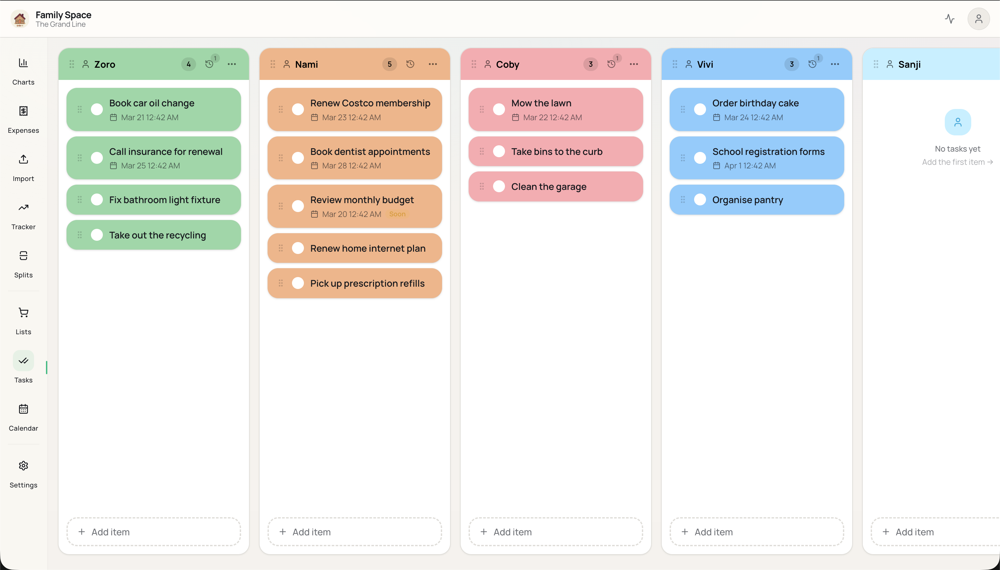

# Family Space

A self-hosted home base for one family: shared grocery lists and chores, a
family calendar, and household finances (expenses, income, budgets, splits,
trackers and yearly analytics) in one app.

One deployment serves one family. You run it on your own Supabase project and
decide who gets an account.



## Features

- **Board** — grocery lists per store and chore lists per person, with drag and
  drop, focus mode, recurring items (RRULE), history and search.
- **Calendar** — in-app week/month calendar of dated items, an upcoming
  timeline, and an optional embedded Google Calendar view.
- **Expenses and income** — monthly table with inline edits, bulk actions,
  duplicate detection and recurring transactions with catch-up.
- **Import** — CSV import with column mapping, and AI PDF bank-statement import
  through Google Gemini (bring your own API key).
- **Analytics** — yearly charts by month, category, location and person, with
  PDF and Excel export.
- **Budgets, splits and trackers** — per-person and per-category budgets,
  Splitwise-style groups, and debt/savings trackers.
- **Family** — activity feed, members with their own "Paid by" person,
  per-family currency and locale.
- **Sign-in** — email/password and Google. Sign-ups are off; the owner creates
  accounts.

## Deploy your own

**[Deploy from your browser](https://family-space-deploy.usmankm.com)**: fill
in a short form with free Supabase and Vercel accounts, and get your own
instance in about ten minutes.

Prefer the command line? Use the setup script:

```bash
npm install
scripts/setup.sh          # hosted Supabase (+ optional Vercel deploy)
# or
scripts/setup.sh --local  # local Supabase in Docker
npm run dev               # http://localhost:3000
```

Then sign in as the owner. The first sign-in runs onboarding.

- [docs/self-hosting.md](docs/self-hosting.md) — the deployer, the setup
  script, Google sign-in, adding family members
- [docs/deployment.md](docs/deployment.md) — Vercel and the mobile app
- [DEVELOPER.md](DEVELOPER.md) — local development and conventions
- [docs/CODEBASE.md](docs/CODEBASE.md) — where things live

## Stack

Turborepo + npm workspaces · TanStack Start (React, Vite, SSR) · Supabase
(Postgres + RLS, Auth, Storage) · Tailwind CSS v4 · shadcn/ui · TanStack Query
and Table · Recharts · dnd-kit · Expo (mobile app, `apps/mobile`).

## Repository layout

```
apps/web        Web app (TanStack Start)
apps/mobile     Expo app
apps/deployer   Browser deployer (family-space-deploy.usmankm.com)
packages/       Shared types, Supabase queries, React Query hooks, utils, config
docs/schema.sql Complete database definition
supabase/       Supabase CLI config (auth, storage)
scripts/        setup.sh
```

## License

[MIT](LICENSE)
